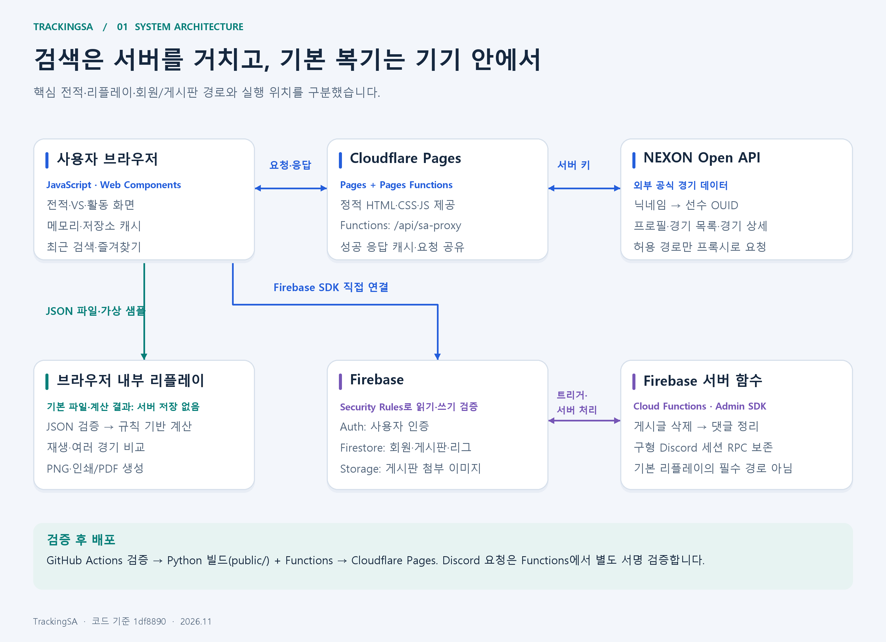
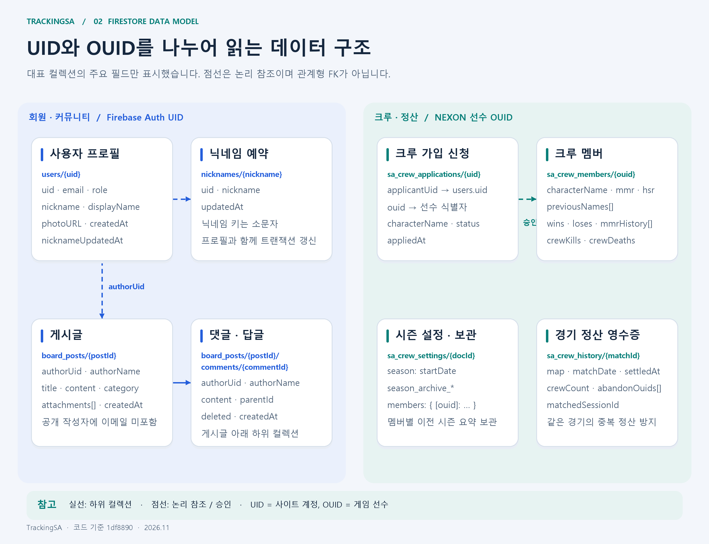

# TrackingSA — 게임 기록을 검색에서 복기까지 연결하는 서비스

**서든어택 전적 검색·경기 비교·리플레이 분석을 직접 기획·개발·운영하고 있습니다.**

[운영 서비스](https://trackingsa.com) · [전적 검색](https://trackingsa.com/stats/sudden-attack/) · [리플레이 체험](https://trackingsa.com/stats/sudden-attack/replay/) · [개발일지](https://blog.naver.com/PostList.naver?blogId=hantiger24&from=postList&categoryNo=33)

| 기간 | 역할 | 개발 방식 |
| --- | --- | --- |
| 2026.02 ~ 현재 | 개인 프로젝트: 기획, 화면·서버리스 API 개발, 구조 설계, 검증·배포·운영 | Codex를 기획·구현·검증에 활용하고 문제 정의와 결과 판단을 직접 수행 |

이 저장소는 **2026.11.24에 확인한 최신 원본을 바탕으로 갱신한 공개 포트폴리오**입니다. 소스와 테스트를 살펴볼 수 있으며, 운영 계정·설정값은 예시값으로 바꿨습니다. 기준 커밋과 공개판의 차이는 [공개판 안내](docs/portfolio-snapshot.md)에 정리했습니다.

## 먼저 볼 내용

1. [구조·데이터 모델·유저 플로우](docs/portfolio-system-design.md): 그림 4종과 설계 근거
2. [핵심 API 명세](docs/portfolio-api.md): 요청·응답, 인증, 캐시, 실패 처리
3. [문제 해결 사례](docs/portfolio-case-studies.md): 캐시 무효화, 실패와 0의 구분, 리플레이 상태 관리
4. [핵심 소스와 테스트](#핵심-소스와-테스트): 기능별 구현과 검증 코드
5. [공개판 검증 기록](docs/portfolio-verification.md): 이번 갱신에서 실제 실행한 검사와 범위

## 무엇을 만들었나

| 기능 | 이용자가 할 수 있는 일 |
| --- | --- |
| 전적 검색 | NEXON Open API로 프로필·최근 경기·경기 유형별 기록·활동 조회 |
| 비교와 내전 도구 | VS 비교, 최근 상대·라이벌 분석, 크루 랭킹, 팀 밸런서 |
| 한 경기 복기 | 공식 JSON의 라운드 흐름·주요 장면·선수별 사건 확인, 재생·PNG·인쇄/PDF |
| 여러 경기 비교 | JSON 2~5개에서 같은 선수 ID의 검증된 기록과 기준·이후 경기 지표 비교 |
| 다시 찾기와 공유 | 최근 검색·즐겨찾기, 전적 요약 이미지, 분석 가이드 |
| Discord 연결 | `/전적`·`/리플레이`·`/도움말` 요약과 웹 상세 분석 연결 |

**기본 리플레이 분석은 규칙 기반 계산입니다.** 파일 분석·재생·비교는 기기 안에서 처리하며 비교 파일과 계산 결과를 서버에 저장하지 않습니다. 경기 유형·전력 등 추가 조회에는 외부 API를 사용합니다. 그래프의 추정치와 상황 지수는 실측 승률 또는 생성형 AI의 판단이 아닙니다. 실제 파일 없이 가상 샘플로도 체험할 수 있습니다.

유료 AI·결제 관련 준비 코드는 공개 서비스의 기본 리플레이 기능과 구분합니다. 이 포트폴리오는 실제 판매·유료 AI 활성화나 매출 성과를 주장하지 않습니다.

## 어떤 문제를 해결했나

### 같은 기록을 반복해서 요청하는 문제

프로필 캐시와 경기 목록 캐시를 분리하고, 같은 요청이 진행 중이면 그 결과를 공유하도록 구성했습니다. 강제 새로고침에서는 메모리·저장소 캐시를 함께 무효화하고, 늦게 도착한 이전 응답이 새 결과를 덮지 않도록 처리했습니다.

날짜별 화면에서도 API가 제공하는 조회 범위는 같았습니다. 유형별 목록을 재사용하고 날짜 선택 시 필요한 상세 기록만 조회하도록 개선했습니다. [개발 기록](https://blog.naver.com/hantiger24/224468800253)의 **150회 → 5회**는 정해진 모의 조건의 목록 요청 수이며, 실서비스 전체 호출 수나 속도·비용 절감률을 뜻하지 않습니다.

### 데이터가 없는 상태가 실제 0처럼 보이는 문제

정상 응답의 빈 목록, 일부 조회 실패, 전체 실패를 구분했습니다. 이전 경기 기록이 없는 경우 최근 값을 복사해 비교하지 않고, 불완전한 기록으로 통계를 확정하지 않도록 했습니다. 사용자에게 보여줄 지표와 데이터 출처를 함께 정리했습니다. [관련 개발일지](https://blog.naver.com/hantiger24/224481064331)

### 파일을 바꾼 뒤 예전 분석 결과가 도착하는 문제

리플레이 파일·분석 세션, 선택적 전력 조회, 이미지/PDF 출력의 책임을 분리했습니다. 결과를 반영하기 전에 현재 파일과 작업 번호가 유효한지 확인합니다. 파일 교체 중 늦게 끝난 요청, 반복 종료 처리, 뒤로 가기 복원 등 상태 전환을 테스트했습니다.

### 구현한 기능을 검증하고 배포하는 과정

`src`를 원본으로, `public`을 생성 산출물로 관리합니다. 단위·Python·로컬 브라우저 검사와 계층 경계 검사로 기능과 산출물을 확인합니다. 원본 서비스는 공통 검증 성공 후 배포하도록 구성되어 있으며, 공개판의 운영 배포 작업은 실행되지 않도록 제한했습니다.

## 기술과 구조



전적 조회는 키를 보관한 서버 프록시를 거치고, 기본 리플레이 분석은 브라우저 안에서 처리합니다. 로그인·게시판·크루는 Firebase SDK와 보안 규칙을 사용합니다. [실행 경로와 코드 근거](docs/portfolio-system-design.md#1-아키텍처)

| 영역 | 사용 기술 |
| --- | --- |
| 화면 | JavaScript ES Modules, Web Components, Shadow DOM, HTML/CSS |
| 서버리스 API | Cloudflare Pages Functions, NEXON Open API, Discord Interactions |
| 인증·저장 | Firebase Auth, Firestore, Storage 및 보안 규칙 |
| 별도 서버 함수 | Firebase Cloud Functions |
| 빌드·검증 | Python 정적 사이트 빌더, Node.js 테스트, Playwright, GitHub Actions |

```text
src/domains/       전적·리플레이·게시판 등 기능별 원본
  .../domain/     계산 규칙·검증·지표
  .../application/ 조회 흐름·세션·유스케이스
  .../infra/      외부 API·저장소 연동
  .../ui/         화면 구성과 사용자 상호작용
src/shared/       공통 UI·자산·빌더
functions/        같은 출처 /api 핸들러
cloud-functions/ 별도 서버 함수
tests/            단위·Python·브라우저·Emulator 검사
public/           빌드로 생성한 결과
```

### 데이터 구조와 사용자 동선



회원 계정 UID와 게임 선수 OUID를 구분하고, 게시글·댓글의 하위 컬렉션과 크루 정산 구조를 표시했습니다. 점선은 코드의 논리 참조이며 관계형 외래 키가 아닙니다.

- [전적 검색 → 비교·공유 흐름](docs/portfolio-system-design.md#3-전적-검색-유저-플로우)
- [JSON → 한 경기 복기·여러 경기 비교 흐름](docs/portfolio-system-design.md#4-리플레이-분석-유저-플로우)
- [API 명세와 Firebase SDK 계약](docs/portfolio-api.md)

## 핵심 소스와 테스트

| 주제 | 구현 | 테스트 |
| --- | --- | --- |
| 프로필 조회·캐시 | [조회 서비스](src/domains/stats/sudden-attack/application/profile-query-service.js) | [조회 테스트](tests/unit/profile-query-service.test.js) |
| 외부 API 요청 | [NEXON 클라이언트](src/domains/stats/sudden-attack/infra/nexon-api-client.js) | [API 테스트](tests/unit/nexon-api-client.test.js) |
| 리플레이 상황 계산 | [계산 규칙](src/domains/stats/sudden-attack/replay/domain/replay-context.js) | [상황 테스트](tests/unit/replay-context.test.js) |
| 여러 경기 비교 | [비교 계산](src/domains/stats/sudden-attack/replay/domain/replay-comparison.js) | [비교 테스트](tests/unit/replay-comparison.test.js) |
| 비교 세션 관리 | [세션 처리](src/domains/stats/sudden-attack/replay/application/replay-comparison-session.js) | [단위 테스트 모음](tests/unit/) |
| 실제 화면 흐름 | [전적 검색 UI](src/domains/stats/sudden-attack/ui/) | [로컬 브라우저 검사](tests/e2e/local-smoke.spec.js) |

설계·구현 당시 상세 기록은 [기술 문서 목차](docs/README.md)에서 확인할 수 있습니다. 과거 문서의 측정값·검증 횟수는 각각의 시점과 범위에 해당하며 이번 공개판의 재검증 결과와 구분합니다.

## 로컬 실행

Node.js 24와 Python 3.11 이상이 필요합니다. Windows PowerShell 기준:

```powershell
npm.cmd ci
python -m pip install -r requirements.txt
npm.cmd run build
npm.cmd run test:unit
npm.cmd run test:python
npx.cmd playwright install chromium
npm.cmd run test:e2e:ci
python -m http.server 4173 --directory public
```

`http://localhost:4173`에서 화면을 볼 수 있습니다. 기본 빌드와 모의 데이터 검증에는 운영 비밀 키가 필요하지 않습니다. 실제 로그인·외부 API·Discord 연동에는 별도의 본인 계정 설정과 서버 환경변수가 필요합니다. 공개판에 포함된 예시 설정으로 운영 서비스에 접속하거나 배포하지 않습니다.

## AI 활용 방식

이용자의 문제와 기대 동작을 먼저 정리하고, Codex에 관련 코드 확인·작업 분해·구현을 요청합니다. 예상과 다른 결과는 재현 조건과 함께 전달합니다. 변경 후에는 코드와 테스트 결과, 필요한 화면 동작을 확인합니다. AI가 작성한 코드도 확인 대상이며, 어떤 문제를 풀지와 완료 여부를 판단하는 역할은 직접 맡습니다.

## 화면과 기록

현재 화면과 가상 리플레이 체험은 [운영 서비스](https://trackingsa.com)에서 확인할 수 있습니다. 위의 구조도 4종은 최신 원본 코드를 기준으로 제작했습니다. `docs/images/`의 기존 화면 캡처는 과거 기록이며 최신 UI를 뜻하지 않습니다.

- [개발일지 모음](https://blog.naver.com/PostList.naver?blogId=hantiger24&from=postList&categoryNo=33)
- [전적·리플레이 가이드](https://trackingsa.com/guides/replay-analysis-guide/)
- [공개 범위와 원본 기준](docs/portfolio-snapshot.md)
- [이번 갱신의 검증 결과](docs/portfolio-verification.md)
