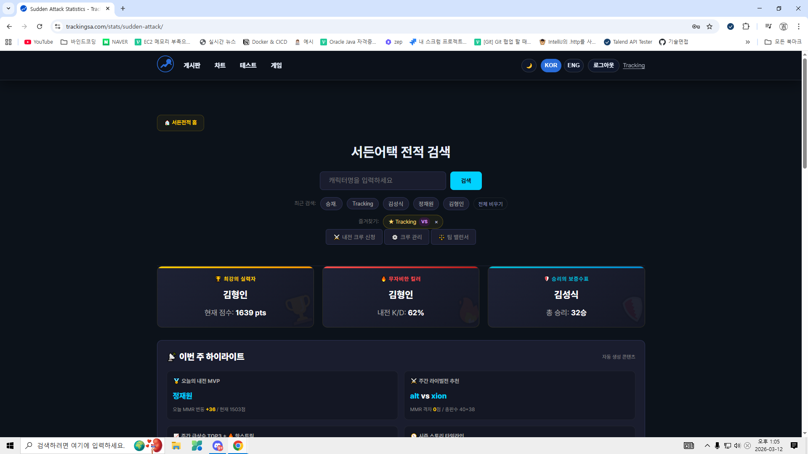
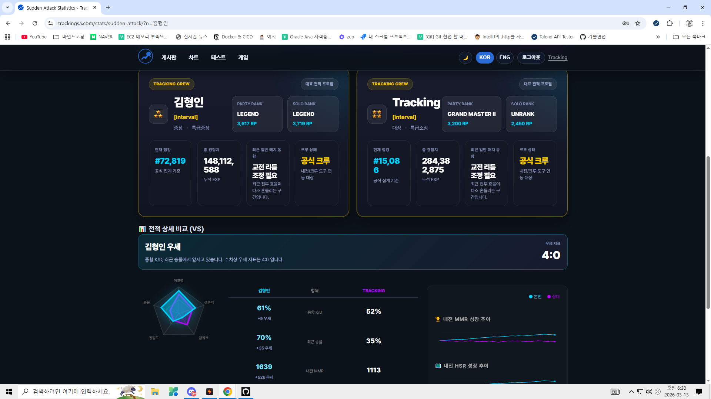
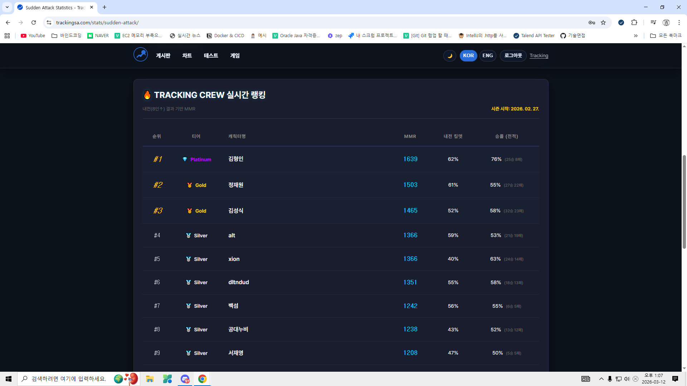
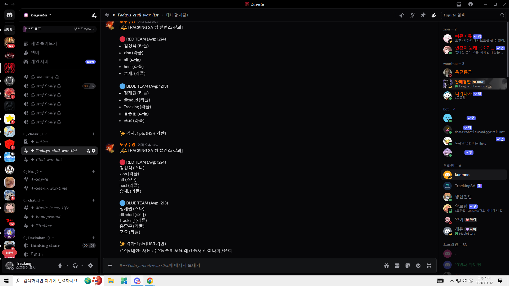

# README 정리 전 기록 — 2026-10-28

> 아래는 문서 정리 직전 README의 본문을 보존한 기록이다. 당시에도 여러 시점의 설명이 섞여 있었으므로 현재 기능·한도·심사·배포 상태의 기준으로 사용하지 않는다. 본문은 보존하고 이 보관 위치에 맞춰 상대 링크만 조정했다.
>
> 현재 안내: [프로젝트 소개](../../README.md) · [문서 목차](../README.md) · [현재 상태](../current-status.md). 특히 아래의 50회 상품, 로그인/접근코드 전용 TEST, 이전 한도, 미촬영·미배포 문구는 후속 변경으로 대체된 이력일 수 있다. 과거 검증 수치는 현재 전체 검사 수가 아니다.

---

# Tracking SA

**NEXON Open API 기반 서든어택 전적 검색·분석 웹 서비스**

[서비스 바로가기](https://trackingsa.com) · [전적 검색](https://trackingsa.com/stats/sudden-attack/)

Tracking SA는 직접 기획·개발·운영하는 웹 서비스입니다. 서든어택 캐릭터의 전적 조회를 중심으로 최근 경기, 경쟁 모드 분석, 전적 비교, 라이벌 분석 등 여러 기능을 하나의 사용자 흐름으로 연결하고 있습니다.



## 주요 기능

### 서든어택 전적 검색 및 분석
- NEXON Open API를 통한 캐릭터 프로필 및 전적 조회
- 최근 20경기, 최근 31일 활동 및 매치 유형별 기록 확인
- 승률, K/D, 헤드샷, 킬·데스 등 주요 지표와 프로필 요약
- 경쟁 모드 분석 및 이전 구간과의 비교
- 최근 상대 전적·상성·라이벌 분석
- 최근 검색, 즐겨찾기, VS 비교 및 재검색 편의 기능
- 크루 랭킹과 팀 밸런서 등 보조 기능



### 리플레이 상황 분석
- 사용자용 [리플레이 분석·비교 가이드](../../src/domains/guides/replay-analysis-guide/index.html): JSON 준비·지수 해석·이탈/재접속·같은 선수 ID 비교를 설명하고, 기본 샘플에서 직접 재현할 수 있는 12라운드 계산 사례를 제공합니다. 가이드 목록과 분석실 첫 화면에서 연결합니다.
- 초기 로딩 최적화: 비교 UI는 비교 탭 또는 비교 샘플을 처음 사용할 때 한 번만 불러오고 세션을 유지합니다. 개발용 모의 UI는 정확한 로컬 테스트 모드에서만 로드합니다. 로딩 중 파일 선택·탭 이동·실패·페이지 이탈도 회귀 검증합니다 ([동작과 검증 범위](../replay-fast-start.md)).
- 빠른 시작: JSON을 읽은 뒤 기본 분석·재생을 바로 사용할 수 있고 전력 조회는 해당 패널만 비동기로 갱신합니다. 선수·파일·기준 변경/초기화 후에는 이전 전력 응답을 적용하지 않습니다. 파일 없이 가상 5대5 경기의 한 경기 분석·두 경기 비교를 체험하는 샘플 버튼도 제공합니다. 샘플은 외부 API·유료 AI·DB 저장 없이 동작합니다 ([동작과 검증 범위](../replay-fast-start.md)).
- AI 사실·조언 선택: 무료 기본 분석을 유지하고 유료 AI를 월 구독에서 구매 횟수권으로 변경. 주문별 잔액·정상 1회 차감·추가 구매·미사용분 환불 잠금/확정·입금/환불 중복 적용 방지와 로컬 HTTP 잔액 표시를 검증. 구매 조건·무료/유료 비교·조건부 환불 안내 미리보기 추가(결제 비활성). 토스페이 공식 TEST API 승인·부분환불·잔액 0원 및 멱등 처리 검증. TEST 전용 서버 연결·원장 증명 검증 포트·주문/환불 연결 저장소 추가(TEST/LIVE 분리, 중복 전송 잠금). 인증 주문 준비·지급 공간 예약에 결제 생성·승인·지급 서버 흐름을 연결. 동시 요청 1회 전송, 생성/승인 응답 유실·DB 지급 실패 복구·중복 지급 방지를 로컬/Emulator에서 검증(별도 결제 옵션 기본 비활성, 합성 제공자 사용). 로컬 구매·복귀 화면을 서버 상품 조회·주문/결제 흐름에 연결하고 계정별 주문 복구·상태 수동 확인·모바일 화면을 검증. 가맹 승인·실거래/콜백·운영 화면 연결·유효기간/약관 확정·운영 배포는 미완료 ([토스페이 검증 범위](../replay-coaching-tosspay.md)) ([횟수권과 비용 경계](../replay-coaching-credits.md), [유료 API](../replay-coaching-paid-api.md), [복기 근거와 화면](../replay-coaching-review.md))
- 심사용 상품·TEST 경로: 2026-10-27 신규 20회·3,300원·365일·자동 갱신 없음과 정상 제공1회당165원 기준 미사용분 환불 안내를 공개 반영. 신규 TEST 주문은 상품 조건을 보관하고 이전50회 TEST 기록은 그대로 조회·복구. 단위1,032/구매·심사 브라우저25/Firestore Emulator7 통과. 공개 상품·약관·개인정보와 TEST 함수 접근 검증 완료. 기존50회 구성에서는 실제 토스 앱 인증→복귀→서버 TEST 승인도 확인했으며, 이번20회 변경 후 새 외부 거래는 생성하지 않음. 가맹 재접수는2026-10-27 사업자가 신청 완료를 전달했으며 실제 판매는 비활성 ([범위와 후속 준비](../tosspay-reapplication-checklist.md))
- 토스페이 재심사 준비: 실제 TEST 완료 증빙과 반려4항목 대조표·담당자 안내 초안 준비. 20회 구성과1회165원 미사용분 환불 안내를 공개 반영했으며 가맹 재접수는2026-10-27 사업자가 신청 완료를 전달했으며 실제 판매는 비활성 ([제공·환불 조건 확정안](../replay-coaching-sales-conditions.md), [재심사 체크리스트](../tosspay-reapplication-checklist.md))
- AI 품질 시험: 이전 자유 문장 계약의 실제/합성 12개 사례·19개 카드에서 수치 오류와 부적절한 조언을 발견해 유료 출시 보류. 이를 바탕으로 사실·조언 선택 계약을 내부 구현했으며 새 계약의 실제 선택 품질은 미검증 ([이전 시험 기록](../replay-coaching-pilot.md))
- AI 호출·복구 준비: 전체 입력 카운트·단일 호출·usage/오류 검증·비용과 결과의 원자적 저장·동일 요청 결과 복구 구현. 실제 API 시험은 로컬 장부에서 수행, 운영 HTTP·구독 판매는 비활성 ([구현과 측정 범위](../replay-coaching-provider.md))
- 로컬 API 준비: 기존 키의 Git 제외 로컬 설정과 Luna 모델 정보 조회 확인 ([키 보관 경계](../replay-coaching-api-setup.md))
- AI 비용 준비: 전체 입력 카운트 어댑터·strict 출력 요청·단가 버전·개인/전체 마이크로달러 예약·일별 제한·영속 중단 검사. 운영 연결은 비활성 ([비용 상한 구현 범위](../replay-coaching-budget.md))
- 해설 품질 대조: 원본 사건에서 독립적으로 수치를 재계산하고 모의 관찰 문장·서버 입력을 대조하는 로컬 검사. 실제 한 경기 10명·9라운드와 합성 경계 상황을 검증했으며 실제 AI 품질 보증은 아님 ([품질 검증 범위](../replay-coaching-quality.md))
- 공식 JSON의 처치·사망 기록으로 첫 처치·첫 사망, 사망 직전 생존 인원, 5초 이내 교환킬 후보, 혼자 남은 상황을 재구성
- 기존 요약 카드·복기할 라운드·사망 상세에 근거와 시각을 표시하고, 참가자 변동이나 기록 불일치가 있는 라운드는 상황 판정 보류
- 상황 분석은 브라우저에서 처리하며 생성형 AI 호출·추가 저장소 없이 동작. 기존 OpenAPI 전력 비교는 별도 기능
- [분석 기준과 검증 범위](../replay-context-analysis.md)
- 후속 AI 해설을 위한 근거 요약 v1: 검증 라운드 전체 집계와 최대 6개 장면, 근거 ID·표본 범위·판정 한계를 로컬에서 생성하며 AI 호출은 하지 않음 ([데이터 계약](../replay-coaching-evidence.md))
- 해설 미리보기: 관찰·연습 제안·한계를 구분한 로컬 모의 응답과 라운드 근거 이동. AI 미연결 상태를 표시하고 잘못된 응답·인용은 표시 보류 ([응답 형식과 화면](../replay-coaching-preview.md))
- 테스트 전용 모의 API 기반: Firebase 인증·UID 허용 목록, 입력 정규화, 월 한도 예약·동시 요청/중복 방지. 기본 비활성·운영 미배포이며 실제 AI와 구독은 미연결 ([서버 계약과 검증 범위](../replay-coaching-server.md))
- 로컬 화면/API 연결: 명시적 요약 전송, 로그인·월 한도 안내, 동일 요청 재확인과 오래된 응답 격리. Auth/Firestore Emulator로 검증하며 운영 호출은 비활성 ([로컬 연결과 실행법](../replay-coaching-local.md))
- AI 비용 설계안: 공식 모델 요금 비교, 월 3,300원 상품의 조건부 한도·비용 시나리오와 실패 정산 기준. 판매·운영 설정에는 미적용 ([비용·한도 계획](../replay-coaching-cost-plan.md))
- 모의 정산 분리: 사용자 성공 횟수와 비용을 별도 확정하고, 전송 전 취소·전송 후 미확정 종료·늦은 응답 차단을 로컬에서 검증. 실제 청구·운영 복구는 미실행 ([정산·복구 기준](../replay-coaching-settlement.md))
- 모의 이용 기간: 서버가 지정한 월간 기간별 최대 50회 성공·70회 시도, 달력 월과 별도의 이용권 집계, 갱신 충돌·중복 지급 방지와 제한된 이전 기록 보관. 실제 결제 권한은 미연결 ([이용 기간·한도 기준](../replay-coaching-access.md))

### 홈·커뮤니티 및 외부 연동
- SOOP 서든어택 라이브 방송 카드: 방송 제목·스트리머·시청자 수·시청 링크 표시
- 게시판과 리플레이 분석실 등 서비스 진입점
- 라이트/다크 테마 및 반응형 화면

SOOP 라이브 카드는 API 응답과 외부 서비스 상태에 따라 표시 내용이 달라질 수 있습니다. 코드상 로딩·승인 대기·빈 결과·오류 상태를 구분해 처리합니다.

## 기술 구성

| 구분 | 사용 기술·구현 |
| --- | --- |
| Frontend | JavaScript ES Modules, Web Components, Shadow DOM |
| 데이터 API | NEXON Open API |
| 서버리스 API | Cloudflare Pages Functions의 `functions/api/` 핸들러 |
| 데이터베이스·인증 | Firebase Firestore, Firebase Auth, Firestore Security Rules |
| 빌드 | Python 기반 정적 페이지 생성, `src/` → `public/` |
| 자동화·검증 | GitHub Actions, Node.js 테스트, Playwright, 소스·산출물 검증 스크립트 |

현재 사이트 배포 워크플로는 Cloudflare Pages에 `public/`과 `functions/`를 배포합니다. 공개 전적·공유 이미지·SOOP API의 클라이언트 기본 주소는 같은 출처 `/api`이며 Pages Functions가 처리합니다. Vercel 전용 `api/` 브리지·설정·런타임 패키지는 제거했습니다. Firebase 서버 함수는 `cloud-functions/`에서 별도로 배포합니다. 연결 주소는 `runtime-config.js`와 배포 환경 설정을 함께 확인하며, Cloudflare가 지원하지 않던 절대 주소의 Vercel 200 프록시 규칙은 제거했습니다.

`runtime-config.js`는 브라우저가 재사용할 때 검증하도록 `Cache-Control: no-cache, must-revalidate`를 지정합니다. API 주소 전환·복구 시 이후 조회가 오래된 설정에 묶이지 않게 하며 다른 정적 자산과 API 응답의 기존 캐시 정책은 유지합니다. 이미 저장된 이전 캐시가 즉시 모두 사라지거나 열려 있는 페이지의 설정이 자동으로 바뀌는 것은 아닙니다.

### 도메인 분리와 소스 관리

- 전적 기능의 소스: `src/domains/stats/sudden-attack/`
- 기능 내부를 `domain`, `application`, `infra`, `ui` 등 역할에 따라 분리
- 공식 진입 경로: `/stats/sudden-attack/`
- 기존 `/games/sudden-attack/` 경로는 `_redirects`의 301 규칙으로 전환
- `src/`를 원본(source of truth)으로 관리하고, `public/`은 빌드 산출물로 취급

리그 정산은 `domain/crew-settlement.js`에서 일반 데이터로 계산 계획을 만들고, `infra/crew-settlement-store.js`에서 Firestore 트랜잭션으로 저장합니다. 각 재시도에서 시즌·멤버·경기·대기 명단·수동 탈주 기록을 다시 읽어 전체 계획을 새로 계산하며, 저장 성공 후 알림용 결과를 반환합니다. `CrewRepository`의 기존 호출 방식, MMR/HSR 공식, 수동 탈주 사유·이력, OUID와 이전 닉네임 매칭은 유지합니다. 계산 계획은 입력 이력 배열을 복사하므로 실패한 시도의 점수 변경이 다음 시도에 남지 않습니다.

### Vercel 운영 의존성 정리

사이트·전적·이미지·SOOP·Discord HTTP 요청은 Cloudflare Pages/Functions, 인증·DB·세션 처리는 Firebase를 사용합니다. 공개 `/api/...` URL은 그대로 유지하며 삭제한 루트 `api/` 폴더는 Vercel용 어댑터였고 실제 핸들러는 `functions/api/`에 있습니다. Discord 서명 원문·5분 유효기간·비동기 waitUntil 처리는 유지하고, 기존 어댑터의 요청 본문 64KiB 제한은 Cloudflare 진입점으로 옮겼습니다.

코드 제거와 외부 계정 정리는 구분합니다. Git 자동 배포·기존 프로젝트 중지/삭제·콜백 확인과 검증 범위는 [Vercel 의존성 정리 기록](../vercel-retirement.md)에 남깁니다. Vercel Hobby의 상업적 이용 제한을 피하려고 프록시로 감추는 구성은 사용하지 않습니다.

### 콘텐츠 날짜와 사이트 내부 검색

콘텐츠 날짜는 원본 HTML의 `<head>`에 명시한 `article:published_time` / `article:modified_time` 메타 태그(또는 `name="datePublished"` / `name="dateModified"`)에서 읽습니다. `2026-07-25` 같은 날짜 또는 시간대가 포함된 ISO 시각을 지원하며, 날짜만 있으면 UTC 자정의 일 단위 값으로 취급합니다. RSS의 `pubDate`는 게시일, 사이트맵의 `lastmod`와 검색 결과 날짜는 수정일 우선으로 사용합니다. RSS·사이트맵 시각은 UTC로 정규화하고 검색 결과의 날짜 표시는 한국 시간(UTC+9)을 사용합니다. 날짜가 확인되지 않은 페이지에는 해당 값을 생략하고 파일 수정 시각이나 빌드 날짜로 대체하지 않습니다. 잘못된 날짜·시간대 없는 시각·서로 충돌하는 값·게시일보다 이른 수정일은 빌드를 실패시켜 확인하게 합니다. RSS의 `lastBuildDate`와 검색 인덱스의 `generated_at`은 별도의 생성 시각입니다.

사이트 내부 검색은 기존 영어 제목·설명·키워드를 유지하며 검색용 한국어 별칭을 추가합니다. 검색 필터는 제목·설명·키워드에 모든 검색 단어가 포함되는지 확인합니다. NFKC 문자 정규화, 대소문자와 띄어쓰기 차이를 처리하고, 닉네임을 통한 게임 전적 조회에는 적용하지 않습니다. 브라우저 검증은 현재 제공되는 `/search/` 페이지에서 수행하며, 헤더에 검색창을 추가하지 않습니다.

공개 가이드는 빌드와 통합 페이지 정리를 마친 뒤 `guide_catalog.py`가 실제 배포되는 페이지의 제목·설명·키워드를 읽어 검색 대상에 추가합니다. 기존 수동 검색 항목의 영어 표기가 우선하며, 같은 URL은 중복 등록하지 않습니다. 배포되지 않은 보관 원본과 noindex 페이지는 검색 대상으로 추가하지 않습니다. 공통 상단 메뉴의 가이드 링크와 메인 콘텐츠 카드에서도 전체 가이드·대표 계산 사례로 이동할 수 있습니다.

### 가이드 수동 광고 준비

승률·킬뎃 비교 가이드 `/guides/form-signal-report/`의 본문 하단 한 곳에만 전용 반응형 디스플레이 광고를 준비했습니다. `runtime-config.js`의 `guideAdEnabled`는 현재 `false`이며, 이 상태에서는 영역을 숨기고 수동 광고 요청을 큐에 넣지 않습니다. 기존 공통 AdSense 계정 스크립트와 사이트 확인 메타태그는 유지합니다. 사이트의 AdSense 상태가 ‘준비됨’으로 바뀐 뒤 `true`로 활성화할 수 있으며, 심사 중인 상태를 승인 완료로 취급하지 않습니다.

`guides/guide-ad.js`는 같은 단위를 한 번만 요청하고, 동기 초기화 실패 또는 Google의 `data-ad-status="unfilled"` 상태에서는 영역을 숨깁니다. 광고 SDK가 차단되거나 응답을 주지 않는 상황의 실제 노출·빈 공간·성능은 활성화 시 다시 확인해야 합니다. 검색·리플레이·로그인·게시판에 수동 광고를 추가하지 않았고, 서버 호출·광고 자동 새로고침·별도 광고 측정 저장소는 없습니다.

### 공개 API 요청 시간 제한과 진단

`src/domains/shared/http-request.js`는 요청 한 번에 대해 응답 본문 읽기까지 포함한 대기 상한과 AbortController 취소를 제공합니다. 전적·이미지 프록시의 외부 요청은 10초, SOOP 목록은 첫 페이지와 병렬 추가 페이지를 합쳐 12초, 브라우저의 전적·라이브 요청은 각각 15초입니다. 홈 공지 조회는 App Check 토큰 취득을 포함해 10초입니다. 이 값은 개별 요청/기능 호출의 상한이며 여러 요청으로 구성되는 전체 전적 스캔의 완료 시간을 뜻하지 않습니다. 새 자동 재시도는 추가하지 않았고, 기존 닉네임 not-found 대소문자 후보 조회만 유지합니다. 시간 초과·호출 제한을 캐릭터 없음으로 안내하지 않습니다.

전적 프록시는 성공 응답 캐시와 동일 요청 병합을 유지하며 실패 응답에는 `Cache-Control: no-store`를 사용합니다. SOOP의 기존 유효기간 내 이전 방송 fallback과 추가 페이지 부분 성공도 유지합니다. Cloudflare에서는 기본 Cache API로 공개 성공 응답을 인스턴스 사이에서도 재사용하며 `EDGE_HIT`로 구분합니다. 기존 TTL을 사용하고 오류·인증/세션 응답은 캐시하지 않습니다. 캐시 키는 조회 조건의 해시이며 키 값이나 조회 식별자를 URL에 남기지 않습니다. 캐시 장애 시 기존 처리로 진행하며 새 KV/D1/R2 상품은 필요하지 않습니다. 서버 응답의 `X-Request-ID`와 `Server-Timing`, `tracking_sa_api` JSON 로그로 상태·오류 종류·시간·캐시 HIT/EDGE_HIT/MISS/COALESCED/STALE를 대조할 수 있습니다. 각 핸들러 호출에서 새 요청 식별자와 처리 시간을 기록하며 브라우저 캐시가 재사용한 헤더는 원래 응답 기준입니다.

Discord 인터랙션의 Ed25519 서명은 런타임 Web Crypto로 검증합니다. 서명 원문과 5분 타임스탬프 검사·검증 실패 시 401 처리를 유지하며, JS 암호화 구현을 Pages 번들에 포함하지 않습니다. 이 변경만으로 모든 요청이 무료 CPU 한도 안에 들어간다고 보장하지 않으며 실제 실행 결과와 무료 할당량을 함께 확인합니다.

브라우저의 `tracking_sa_operation` 이벤트는 전적 요청·검색 결과·홈 공지·리그 정산의 완료/실패 종류와 소요 시간을 콘솔에 기록합니다. 요청 URL/쿼리·닉네임/OUID·이메일·본문·API 키·인증 토큰·원본 오류 객체를 이 진단 이벤트에 넣지 않습니다. 브라우저 로그를 서버에 전송하는 수집기나 외부 모니터링/알림 서비스는 추가하지 않았습니다. 실제 서버 로그의 보존·샘플링·대시보드 설정은 호스팅 환경에서 별도로 확인해야 합니다. 정산 쓰기는 시간 초과로 취소하거나 재시도하지 않으며 기존 트랜잭션 결과를 그대로 유지합니다.

### 5분 캐시 및 백그라운드 재검증

`src/domains/stats/sudden-attack/application/profile-query-service.js` 구현 기준:

1. 캐시가 없을 때 최신 데이터를 조회합니다.
2. 캐시가 **5분 이내**이면 저장된 데이터를 반환하고 재검증을 생략합니다.
3. 캐시가 **5분 초과**이면 기존 데이터를 먼저 보여준 다음 백그라운드에서 재조회합니다.
4. 같은 캐시 키로 동시에 요청되면 진행 중인 요청(Promise)을 재사용합니다.
5. 메모리 캐시와 로컬 스토리지를 사용하며 캐시 키에 캐릭터명과 조회 범위를 반영합니다.

관련 구현: [ProfileQueryService](../../src/domains/stats/sudden-attack/application/profile-query-service.js), [SaProfileCache](../../src/domains/stats/sudden-attack/application/sa-profile-cache.js)

### SOOP 라이브 연동

`src/domains/home/soop-live.js`는 `/api/soop-live` 또는 런타임 설정의 API 주소를 사용합니다. 사용자에게 방송 목록을 보여주되 로딩·승인 대기·오류·데이터 없음 상태를 분리하고, 외부 응답 문자열을 이스케이프 처리합니다.

SOOP는 공통 `apiBaseUrl`과 `soopLiveMode: 'paged'`를 사용합니다. 페이지 모드 설정이 없으면 기존 단일 목록 요청을 유지합니다. 페이지 모드의 `/api/soop-live?page=1..10`은 함수 한 번에 제공자 한 페이지만 읽고, 허용된 카드 필드만 반환합니다. 브라우저는 첫 응답의 페이지 수를 기준으로 최대 4개씩 병렬 조회한 뒤 공용 순수 모듈 `soop-broadcasts.js`로 전체 interval 우선·유효 중복·동률 순서를 보존해 최종 12개를 고릅니다. 전체 15초 상한·실패한 추가 페이지 제외·페이지별 30초 캐시와 유효기간 내 stale fallback을 적용하며 자동 재시도는 하지 않습니다. Client ID와 제공자의 다른 메타데이터는 페이지 응답에 포함하지 않습니다. 페이지 수에 따라 함수 호출·전송량이 늘어나므로 무료 CPU 적합성과 표시 속도는 실제 배포 측정 후 판단합니다.

현재 런타임 설정은 전적·이미지·SOOP 모두 같은 출처 `/api`를 사용하며 SOOP는 페이지 모드입니다. 복구는 Cloudflare의 이전 정상 배포를 사용합니다. 기존 단일 목록 처리도 Cloudflare 핸들러에 남아 있으며 Vercel 복구 경로는 제공하지 않습니다. 실제 CPU·요청 한도 검증과 넥슨·광고 서비스 이용 조건 확인은 별개로 관리합니다.

관련 구현: [SOOP UI](../../src/domains/home/soop-live.js), [Pages Functions 핸들러](../../functions/api/soop-live.js)

## 서비스 운영 경험

제공한 Google Analytics 캡처의 **2026년 9월 22일~10월 19일** 보고서 기준:

| 지표 | 값 |
| --- | ---: |
| 활성 사용자 | 433명 |
| 신규 사용자 | 406명 |
| 사용자당 평균 참여 시간 | 1분 31초 |
| 이벤트 수 | 약 4,900회 |

이 수치는 특정 과거 기간의 스냅샷이며 실시간 수치가 아닙니다. 다른 날짜 범위의 홈 대시보드 수치와 합산하지 않습니다.

## 리플레이 고도화와 코드 정리 (2026-10-25)

공식 리플레이 JSON의 사건을 라운드 상황으로 재구성하는 1단계 분석과 R01~R11 코드 점검을 완료했습니다. 생성형 AI 연결은 후속 단계이며 이번 구현은 브라우저의 규칙 기반 분석입니다.

| 영역 | 변경 내용 | 확인한 효과·보존 기준 |
| --- | --- | --- |
| 리플레이 | 첫 처치·사망, 생존 인원, 교환킬 후보·혼자 남은 상황 재구성 | 불완전한 라운드는 판정 보류, 유료 AI 호출 없음 |
| 출력·중복 코드 | 공통 HTML 이스케이프, 게시판 초기화 대기 통합, 고아 파일·미사용 의존성 제거 | 화면 출력과 원본 닉네임을 구분해 식별·복사 동작 유지 |
| 검색·공유 | 검색 진행/경기 목록, 공유 모델/캔버스/사진 편집 분리 | 늦은 검색 응답 보호, 고정 PNG 샘플 2개 바이트 동일 |
| 리그 저장소 | 멤버·신청·경기·시즌 책임별 모듈 분리 | OUID·위장닉 복귀·0승0패·정산 정책 보존 |
| 초기 로딩 | 공통/리그 컴포넌트 등록 분리 | R10 로컬 비교에서 JS 요청 5개·본문 31,968바이트 감소 |
| 빌드·CI | Node/Python 공용 배포 명세, AST 구문·소스 연결 검사 | 누락 파일·미연결 후보·지정한 역방향 참조·순환 탐지 |

| 최종 푸시 후보의 로컬 검증 | 결과 |
| --- | ---: |
| Node 단위 테스트 | 659/659 |
| Python 테스트 | 41/41 |
| 로컬 Chromium | 53/53 |
| 실제 SDK·Firestore/Storage 규칙 | 54/54 |
| 인증·게시판 브라우저 | 11/11 |
| 원본/산출물 | JS/CSS 159개, 필수 파일 256개 |

R10 수치는 390px의 새 브라우저 컨텍스트에서 외부 요청을 차단하고 압축 전 응답 본문을 비교한 단계별 측정입니다. 운영 CDN 전송량·실사용자 속도·PageSpeed 점수나 이후 단계의 총량을 의미하지 않습니다. 상세 근거와 검사 한계는 [코드 점검 기록](../code-audit-2026-10-25.md), [리플레이 분석 기준](../replay-context-analysis.md)에 있습니다.

## 개발 및 검증

2026-10-25 코드 점검의 R01~R11 정리·로컬 회귀 검증을 마쳤습니다. 변경 범위와 단계별 결과는 [점검 체크리스트](../code-audit-2026-10-25.md)에 기록했습니다. 전체 서비스의 모든 오류나 외부 서비스 동작을 보장하는 결과는 아닙니다.

```bash
npm ci
npm run build
npm test
npm run test:python
npm run check:source-of-truth
npm run check:build-artifacts
npm run check:application-browser-boundary
npm run check:source-graph
npm run test:e2e:ci
```

설치·실행 순서와 검사 범위는 [개발·검증 가이드](../development.md)를 참고합니다. 사이트 개발/CI는 Node.js 24, Python 3.11 이상을 사용하며 Firebase 서버 함수는 Node.js 22를 유지합니다. Windows PowerShell에서는 `npm.cmd`/`npx.cmd`를 사용하고, Playwright Chromium과 선택적 Emulator 도구를 따로 준비합니다. `npm test`와 기본 브라우저 명령은 로컬 검사이며, 배포 사이트 검사는 `test:e2e:production`으로 명시합니다.

check:application-browser-boundary는 지정된 application 브라우저/DOM 구문을, check:source-graph는 브라우저 원본 연결·누락·일부 계층 참조·모듈 순환을 검사합니다. 기존 check:ddd-boundary는 첫 검사의 호환 명령입니다. 검사 파서 Acorn은 개발 의존성으로만 설치하며 웹에 배포하지 않습니다. 미사용 선언/개별 export나 모든 실행 경로를 검증하는 도구는 아닙니다.

공개 전적 검색과 검색 이후 행동의 기준은 [제품 측정 명세 v1](../product-measurement.md)에 정리했습니다. [공통 전송 기반](../product-analytics-runtime.md)에 검색 시작·첫 결과·종료·핵심 지표 노출, 즐겨찾기 상태 변경·VS·공유 이벤트를 연결했습니다. 캐시/갱신 실패·요청 대체와 복사/기기 공유 완료·취소·PNG 다운로드 요청을 구분합니다. [운영 수신 점검 기록](../product-measurement-verification.md)에 GA DebugView의 이벤트 9종 수신과 이미지 첫 시도 미종료·재시도 성공을 기록했습니다. [분석 보고서와 기준 데이터 절차](../product-measurement-reports.md)는 맞춤 차원 14개·밀리초 지표·탐색 7개 탭의 저장된 설정과 production 필터를 설명합니다. 6번은 production/v1과 점검 데이터의 분리 집계를 확인했고, 배포 전후가 섞이지 않는 완료일 기준 표본을 기다리고 있습니다. 현재 부분일 자료를 개선 효과로 해석하지 않습니다. [무료 운영 원칙](../free-operation-policy.md)에 따라 BigQuery 연결안을 철회했으며 기존 GA 보고서와 수동 내보내기·로컬 집계를 사용합니다. p50/p95와 순서 있는 세션 비율은 현재 범위에서 미산출이며 완료 필수 조건에서 제외했습니다. 큐·중복·허용 필드 검사와 SDK 실패 보호, 점검 모드, URL 정규화 범위도 문서화했습니다.

`npm run build`, `npm run build:full`, `python main.py --build-only`는 모두 기존 `public/`을 비우고 원본에서 다시 생성합니다. 삭제·이름 변경한 페이지와 JS/CSS·이미지의 옛 경로가 다음 배포에 남지 않습니다. `--build-only`는 기존 CI 명령과의 호환을 위해 유지하며 증분 복사를 뜻하지 않습니다. 배포할 정적 파일은 `src/static/` 등 원본 경로에 두고, `public/`에만 둔 파일은 빌드 시 제거됩니다. API·서버 코드와 운영 Firestore/Storage 데이터는 이 로컬 생성 폴더 정리의 대상이 아닙니다.

`check:source-of-truth`는 JS/CSS 원본과 배포본의 누락·불일치를 검사합니다. 공용 UI와 런타임 설정, `scripts/public_sync_map.txt`의 명시적 매핑도 포함합니다. 소스 폴더가 없어도 실패합니다.

브라우저 저장소가 차단되거나 가득 차도 앱의 테마·로그인 안내·전적 조회가 저장소 예외로 중단되지 않도록 처리합니다. 캐시는 읽지 못하면 원본 데이터를 조회하고, 최근 검색·즐겨찾기 저장에 실패하면 현재 페이지 메모리에서 사용합니다. 이 임시 목록과 저장하지 못한 로그인 복귀 주소는 새로고침·다른 페이지 이동 이후 보존되지 않을 수 있습니다. 서버 데이터 저장 권한과 인증 SDK의 지속 로그인 정책은 별도로 유지합니다.

게시판 첨부 이미지 정리는 소유권이 확인된 경로만 처리하며, 일시적인 Storage 오류는 객체별 최대 3회 시도합니다. 이미 없는 객체는 정리 완료로 취급하고 권한 오류는 재시도하지 않습니다. 삭제·이미 없음·최종 실패·소유권 불일치 제외 결과를 반환하며, 최종 실패는 사용자 안내와 브라우저 경고에 남깁니다. 글 저장 성공 후의 정리 실패는 새 첨부를 되돌려 삭제하지 않습니다. 정리 실패가 남아도 글 저장·삭제 결과는 유지되며, 페이지를 벗어난 뒤 자동 재개하는 영구 대기열이나 기존 파일 일괄 삭제는 수행하지 않습니다.

화면의 인증 상태 접근은 `src/domains/auth/infra/auth-gateway.js`에서 통합합니다. 계정·회원가입·게시판·리그는 이 모듈로 초기 인증 대기, 현재 사용자/프로필, 로그인 요청, 인증 서비스, 상태 구독을 사용합니다. 공용 런타임의 `AuthGateway`를 우선하고 구형 전역 함수·이벤트 및 SDK 전용 사용자의 읽기 호환은 이 경계에만 둡니다. 명시적인 로그아웃 `null`은 과거 SDK 사용자로 대체하지 않으며, 실제 Firebase 세션/프로필 저장과 서버 권한 규칙은 기존 인증 저장소가 담당합니다. 게시판의 기존 `application/authGateway.js`는 호환용 재내보내기입니다.

공지의 14일 노출·최대 5개·날짜 해석은 `board/domain/notice-policy.js`, 게시글 5분·댓글 1분·홈 공지 10분 캐시와 키는 `board/domain/content-cache-policy.js`에서 공유합니다. 게시판 변경 시 홈 공지 캐시도 이 공통 정책으로 무효화합니다. 만료 시간이 없거나 숫자가 아닌 캐시는 재조회하고, 기존 캐시 버전·구형 개인정보 캐시 제거·저장소 차단 처리는 유지합니다. 관리자 이메일 정책은 `auth/domain/access-policy.js`에서 자동 프로필 관리자 1개, 사이트 관리자 2개, 리그 전용 운영자 3개로 구분하며 리그/서버 staff는 두 그룹을 합친 5개를 사용합니다. 기존 admin 프로필의 사이트 권한은 유지합니다. Firebase 규칙은 JS를 가져올 수 없으므로 단위 테스트에서 각 규칙의 이메일 목록·프로필 분기를 대조하고 Emulator에서 실제 허용/거부를 검사합니다.

`Project Validation`은 main push와 PR에서 전체 단위 테스트·계층 검사·Python 테스트·실제 빌드·로컬 Chromium 확인·Firestore/Storage Emulator 권한 테스트를 실행합니다. 수동 사이트 배포도 같은 워크플로를 호출하며 모든 검사가 성공해야 배포합니다. 검증 작업은 운영 비밀 키를 받지 않습니다. `test:e2e:ci`는 새 로컬 빌드를 대상으로 홈→전적 진입, 리플레이 오류 처리, 가이드 이동을 확인하고 모든 외부 요청을 차단합니다. 기존 배포 사이트 smoke는 명시적인 운영 설정과 명령으로 구분합니다. Chromium은 `npx playwright install chromium`으로 준비하고, Emulator 설치/실행은 `tests/emulator/README.md`를 참고합니다.

빌드 후 `check:build-artifacts`는 `scripts/deployment-artifacts.js`를 기준으로 주요 페이지, 복사 자산, PWA 아이콘, 배포 설정, 검색 인덱스·RSS·사이트맵·빌드 정보를 검사합니다. 통합된 옛 가이드는 명시한 301 리디렉션과 목적지 페이지가 있어야 제외됩니다. CI에서는 빌드 커밋 일치까지 확인한 뒤 규칙 배포와 Pages 업로드를 진행합니다. 새 필수 페이지나 의도적 제외를 추가할 때 이 목록도 갱신합니다.

Firebase 서버 함수의 소스는 `cloud-functions/`이며 Node.js 22를 사용합니다. `cloud-functions/package.json`의 `engines.node`를 기준으로 `firebase.json`의 런타임과 패키지 잠금 파일을 맞춥니다. 함수 배포 CI는 이 패키지에서 Node 버전을 직접 읽고, 같은 버전에서 전체 단위 테스트를 통과한 뒤 배포합니다. 배포 후 실제 두 함수의 런타임도 검사합니다. 정적 사이트의 별도 빌드 CI는 Node.js 24를 사용합니다.

## 문제 해결과 개선

- **반복 전적 검색:** 최근 검색·즐겨찾기·캐시·백그라운드 재검증으로 재조회 흐름 개선
- **코드 유지보수:** 전적 기능을 별도 stats 도메인으로 정리하고 계층별 책임 분리
- **배포 산출물 불일치:** 원본/산출물 경계를 명확히 하고 자동 검사 적용
- **외부 API 상태 변화:** 로딩·오류·빈 상태를 구분해 사용자에게 전달

## 스크린샷

아래 이미지는 저장소에 현재 등록되어 있는 스크린샷입니다. 실제 최신 화면은 서비스에서 확인할 수 있습니다.

| 전적 검색 | VS 비교 |
| --- | --- |
|  |  |

| 크루 랭킹 | Discord 사용 예 |
| --- | --- |
|  |  |

## 링크

- [Tracking SA](https://trackingsa.com)
- [서든어택 전적 검색](https://trackingsa.com/stats/sudden-attack/)

인증·작성 통합 검증은 `npm run test:e2e:auth:local`로 실행합니다. 운영과 같은 Firebase 브라우저 SDK를 로컬에서 제공하고 Auth·Firestore Emulator에 연결해 로그인, 닉네임, 글·댓글, 관리자 공지 권한을 실제 화면과 저장 결과까지 확인합니다. 설치와 실행 범위는 `tests/e2e/README.md`를 참고합니다.

모바일 흐름의 [로컬 점검 결과](../mobile-flow-audit.md)에 390/402/1280px·밝은/어두운 화면과 공유·오류·사진 조정 등 19개 시나리오의 관찰을 정리했습니다. 공유 취소 후 안내 잔류, 완료 응답 대기 시 복구 부족, 다운로드 안내와 터치 영역·정보 배치 개선 항목을 확인했습니다. 실제 휴대폰·운영 클립보드와 이전 첫 이미지 복사 문제의 근본 원인은 미확인입니다. 이 점검은 기능 수정이나 개선 효과 입증을 의미하지 않습니다.

[모바일 흐름 개선 구현](../mobile-flow-improvements.md)은 공유 대기 시 PNG 대체 경로·취소/다운로드 안내·늦은 응답 보호, 접을 수 있는 공유/사진 편집, 핵심 통계·최근 변화 우선 배치와 VS 접근성·터치 영역을 설명합니다. 같은 합성 화면에서 결과 시작부터 첫 승률 카드까지의 거리는 390px 폭에서 2,326→622 CSS px로 줄었습니다. 실제 사용자 성능·전환 개선 수치가 아니며, [배포·운영 확인 기록](../mobile-flow-release.md)에 Site Deploy #704 성공, CI 697개·운영 파일/구조 15개 확인을 남겼습니다. 실제 iPhone/Android 공유·클립보드는 미확인입니다.

[모바일 공유·정보 배치 개선 사례 초안](../case-study-mobile-sharing.md)에 문제와 재현 범위, 설계 판단, 배치 수치·CI·운영 검증 근거와 AI 활용을 정리했습니다. 실제 이용 효과와 개인 기여 확인을 남긴 포트폴리오 초안이며 공개 발행·최종 제출본은 아닙니다.

[홈 첫 화면 표시 개선](../home-first-render.md)은 홈에 한해 공통 스크립트 세 개를 `defer`로 전환한 범위와 실행 순서 검증을 설명합니다. 외부 서비스를 차단한 같은 모바일 로컬 조건에서 각 3회 측정한 FCP 중앙값은 1,204→828ms였습니다. 실제 사용자 성능이나 운영 PageSpeed 점수 상승을 의미하지 않습니다.

후속 [홈 CSS 전달 방식 개선](../home-css-delivery.md)은 원본 공유 CSS를 빌드할 때 홈에 삽입해 첫 화면의 스타일 다운로드 대기를 줄입니다. gzip·캐시를 반영한 로컬 비교에서 첫 방문 LCP 중앙값은 780→600ms였고 재방문은 240→252ms였습니다. 홈 HTML 약 3.2KB 증가와 다른 페이지의 CSS 캐시 재사용 차이를 함께 기록했습니다. 디자인·기능은 유지하며 실제 운영 점수는 별도로 확인합니다.


## 2026-10-27 20회 구성 공개 반영

상품은20회·3,300원·365일·자동 갱신 없음이며 미사용분은 정상 제공1회당165원과 이미 환불한 금액을 뺀 금액으로 안내한다. 공개 상품/약관/개인정보와 JS를 직접 확인했고, 기존 Firebase/App Check 설정·사업자 푸터를 보존했다. 기존 TEST 함수는 ACTIVE·대기0/최대1·같은 두 비밀값·같은 한도를 유지한다. 신규 TEST 기록은 상품 스냅샷을 보관하며 이전50회 기록을20회로 바꾸지 않는다. 로컬 단위1,032·브라우저25·Emulator7 통과. 이번에는 새 외부 TEST 거래·실제 결제·유료AI·재심사 제출·계약 동의·메일·Git 커밋/푸시를 실행하지 않았다. TEST 신규주문 당일 한도는 별도로 확인해 심사 담당자에게 전달해야 하며 임의 초기화/증액하지 않는다.


2026-10-27: 사업자의 후원 종료 결정에 따라 공통 푸터의 운영 후원 링크·후원 안내 페이지·외부 포스타입 결제 링크를 제거하고 기존 `/support` 경로는 홈으로301이동한다. 포스타입 계정/멤버십/기존 외부 결제를 변경한 것은 아니다. 토스페이 재심사 신청 완료는 사업자의 전달을 기록한 것이며 승인 완료를 뜻하지 않는다.


2026-10-27 후속: 토스 재반려에 따라 일반 상품 구매 화면과 계정 인증 기반 TEST 결제 연결을 구현·배포했다. 고객은 운영 접근코드를 입력하지 않으며 서버가 인증된 계정별로 분리한 TEST 소유권을 사용한다. 이전 운영 도구와 기록은 복구용으로 보존한다. 실제 판매·유료AI는 계속 비활성이며, 제출URL이 보이는 실제 상품/토스 결제창 스크린샷을 준비한 뒤 별도 재접수가 필요하다.


### 계정별 일반 구매 TEST 보완 상태 (2026-10-27)

일반 상품 페이지는 로그인·상품 조건 확인·구매 버튼에서 토스 TEST 결제창으로 연결한다. 고객에게 운영 접근코드를 요구하지 않는다. Cloudflare가 기존 Firebase ID토큰으로 등록 회원을 확인하고, 인증된 UID와 기존 비밀값의 HMAC으로 서버 내부 TEST 소유권을 만든다. 브라우저가 지정한 다른 UID/세션을 사용하지 않으며 비밀값은 서버 밖으로 보내지 않는다. 주문별24시간 복구 정보는 계정별 주문번호와 기한만 보관한다. 실제 대금·운영 이용권·유료AI는 계속 비활성이다.

이전 운영 도구는 기존 거래 확인·복구용 별도 주소로 분리하고 noindex/nofollow 및 광고 제외 정책을 적용했다. 일반 상품 페이지에는 도구 링크나 코드 입력란이 없다. 기존 TEST 서버·원장·일일3/요청30/누적10 한도는 그대로 유지한다.

단위1,037·로컬 브라우저33·Python41 검사와 빌드/소스 검사를 통과했다. Cloudflare 최종 ac54ed66 배포 후 공개 상품·JS·개인정보·이전 도구 정책과 비로그인401을 직접 확인했다. 실제 Chrome에서 기존 로그인 계정과 일반 구매 버튼이 보이는 것도 확인했다. 이번에는 새 외부 TEST 주문을 생성하지 않았고 실제 토스창 이동/승인을 다시 검증한 것은 아니다.

주소창 포함 실제 상품/토스창 스크린샷은 아직 준비하지 못했다. Windows 캡처 도구가 현재 브라우저URL을 확인하지 못해 이번 턴 제어를 중단했고 다른 UI방법으로 우회하지 않았다. 실제 증빙을 확보하기 전에 동일한 자료로 재접수를 반복하지 않는다. 가맹 승인이나 이번 보완의 수용을 보장하지 않으며 추가 제출·계약 동의는 실행하지 않았다.


- 운영 구매 연결 준비: 일반 상품 화면에 운영용 세션·고정 API 전송·서버 구매 조건 기록·지급/조회 모듈을 연결하는 경로를 추가한다. 공개 화면은 TEST 모드이며 실제 판매/결제/AI와 새 운영 함수 배포는 비활성이다. [운영 연결 범위](../replay-coaching-production-purchase.md)를 참고한다.

비회원 TEST 심사 경로: 상품 페이지에서 로그인 없이 동의 후 토스 TEST 결제창을 확인할 수 있다. 24시간 서명 쿠키와 기존 TEST 주문을 사용하며 신규 주문은 하루10건·유효 요청100회로 제한한다. 심사 기간 누적10건 제한을 해제하고 실제 출금·운영 이용권·유료 AI는 비활성화한다. 종료/검증 절차는 [토스 재심사 체크리스트](../tosspay-reapplication-checklist.md)의 최신 비회원 경로를 따른다.

리플레이 경기 흐름 재생: JSON 분석 결과에서 상황 우세 지수 그래프, 시간 이동, 1·2·4배속, 생존 인원과 처치·폭탄 기록을 함께 확인할 수 있다. 외부 API·DB·유료 AI를 추가하지 않는 로컬 기능이며, 검증이 어려운 구간의 지수/인원은 보류한다. [동작·계산·검증 기준](../replay-playback.md)을 참고한다.

리플레이 발전 작업은 [단계별 체크리스트](../replay-development-checklist.md)로 관리한다. 첫 단계는 지수 변화가 큰 장면 최대 3개를 표시하고 해당 라운드 안에서 장면 직전으로 이동하는 기능이다.

경기 흐름 재생의 사건 목록에서 선수를 선택하면 현재 라운드·현재 시점까지의 해당 선수 처치·사망과 식별된 폭탄 사건만 확인할 수 있다. 선수 ID를 사용하므로 닉네임이 같아도 기록을 섞지 않으며, 필터 변경은 재생 위치와 상태를 유지한다.

로컬 AI 해설 검증 화면에서는 현재 분석 근거와 일치하는 해설 카드에서 `재생에서 보기`를 누르면 확인된 라운드·시점으로 이동해 일시정지한다. 기존 근거와 재생의 선수 ID·인원을 대조하며, 추가 AI 호출이나 서버 규격 변경은 없다. 운영 유료 AI 접근 제한과 실제 판매 비활성 상태는 유지한다.

상단의 `한 경기 상세 분석`/`여러 경기 비교` 탭에서 분석 방법을 고르면 해당 입력과 결과만 표시한다. 전환해도 각 파일·선수·결과를 유지하고 한 경기 재생은 일시정지한다. 비교 탭에서 JSON 2~5개를 한 번에 선택하면 두 경기 이상에 있는 같은 선수 ID의 기록을 표로 비교한다. 경기별 처치/사망·라운드당 처치·첫 사망·생존율·평균 생존을 검증된 라운드 기준으로 계산한다. 중복·누락·검증 불가 기록은 구분하고, 비교 파일은 현재 페이지 메모리에서만 처리하며 API·AI·DB·기기 영구 저장을 추가하지 않는다.

같은 영역의 `과제 전후 확인`에서 기준·이후 경기를 직접 구분하고 확인할 지표를 고르면 두 그룹의 검증 라운드 수와 지표 증감을 볼 수 있다. 경기별 평균을 단순 평균하지 않고 비율 차이는 %p로 표시한다. 설정은 현재 페이지에만 유지하며 새로고침 뒤에는 파일을 다시 선택한다. 관측 변화가 과제 실행이나 코칭 효과를 입증한다는 뜻은 아니다.

재생 조작부의 `이 시점 이미지`는 현재 시점에서 멈춘 뒤 경기 흐름 그래프·점수·인원·지수·최근 사건을 1080×1080 PNG로 만든다. 기존 요약 공유 카드는 유지하며, 식별자·좌표·원본 파일·URL 쿼리/해시를 제외하고 브라우저에서만 이미지를 생성한다. 검증 보류와 JSON 기록 재구성이라는 한계를 이미지에도 표시한다.

재생은 이탈과 사망을 구분하고, 선수별 상태·입장 시각·처치/사망 합계가 일치하는 이탈·재입장 라운드를 복원한다. 이탈한 선수를 사망으로 중복 차감하지 않으며 확인된 생존 상태에만 재참여를 반영한다. 불명확한 이력은 계속 보류하고, 통계·AI 해설의 엄격한 검증 범위는 유지한다. [복원 범위와 검증 기준](../replay-playback.md)을 참고한다.
