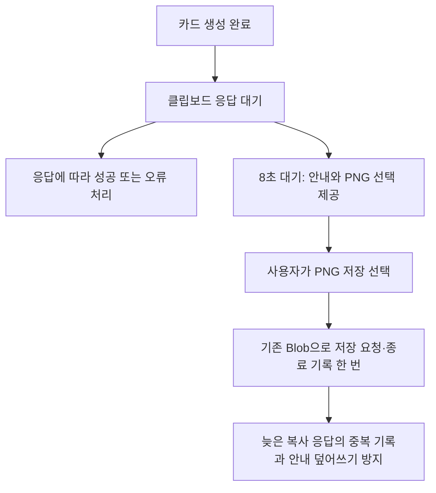

# Tracking SA 사례 초안: 이미지 공유 대기 복구와 모바일 결과 배치 개선

작성일: 2026-10-23 · 상태: 포트폴리오 초안. 구현·배포·검증은 완료했고 실제 이용 효과는 미판정이다.

## 사례 요약

서든어택 전적 검색 서비스 Tracking SA에서 공유 응답을 기다리는 동안 사용자가 다음 행동을 선택하기 어려운 문제와, 모바일에서 핵심 통계까지 긴 화면 이동이 필요한 배치를 정비했다. 공유 단계별 상태와 명시적 PNG 저장 경로를 추가하고, 핵심 KPI를 앞에 배치했다. 같은 합성 화면의 배치 수치, 회귀 검사, CI와 운영 파일 대조로 변경을 검증했다.

| 항목 | 내용 |
| --- | --- |
| 서비스 | [Tracking SA](https://trackingsa.com/) · NEXON Open API 기반 전적 검색·분석 |
| 이번 범위 | 공개 검색 결과의 배치·공유 상태·VS 모달 접근성·회귀 검증 |
| 운영 제약 | 현재 규모의 기존 무료 할당량 활용, 불필요한 API·저장·분석 비용 억제 |
| 보존 조건 | 게임 위장 닉네임/OUID 정책, 정상 0승 0패, 기존 계산식과 공유·사진 편집 기능 |
| 구현 근거 | [모바일 점검](mobile-flow-audit.md) · [개선 구현](mobile-flow-improvements.md) · [배포 확인](mobile-flow-release.md) |

## 1. 증상과 확인한 원인을 구분했다

운영 수신 점검의 첫 이미지 복사에서 PNG는 클립보드에 생겼지만 UI와 완료 이벤트가 끝난 것을 확인하지 못했다. 새 문서에서 재시도했을 때는 성공했다. 이 한 번의 운영 사례만으로 브라우저·권한·이미지 생성·OS 중 어느 지점이 원인인지 확정할 수는 없었다.

로컬에서는 clipboard.write의 완료 응답을 보류하는 fixture로 유사한 양상을 재현했다. 응답이 오기 전까지 버튼은 비활성이고 생성 중 안내와 시작 이벤트만 남았으며, 응답을 해제하면 성공 처리가 이어졌다. 코드에서 확인한 문제는 응답 대기 단계에 대한 안내와 대체 경로가 부족하다는 점이었다. 이 재현을 운영 장애의 근본 원인 확정으로 확대하지 않았다.

별도로 native share 취소 분기에서는 버튼과 취소 이벤트가 복구돼도 진행 중 문구가 남았다. 다운로드 경로는 브라우저에 요청만 했는데 화면에서는 저장 완료로 안내했다. 이 두 문제는 해당 분기의 상태 갱신과 문구를 직접 수정했다.

## 2. 대기와 실패를 같은 상태로 처리하지 않았다

| 설계 결정 | 적용한 처리 | 이유와 한계 |
| --- | --- | --- |
| 생성 대기 제한 | 폰트 2초·장식 이미지 6초·Blob 5초, 컨트롤러 생성 전체 15초 상한 | 상한은 UX 보호를 위한 구현값이며 실측 최적값은 아님. 장식 이미지가 생략될 수 있음 |
| 복사 응답 8초 대기 | 지연 안내와 명시적 PNG 저장 버튼 제공 | 이 시점만으로 성공/실패를 기록하지 않음 |
| PNG 선택 | 이미 생성한 Blob 재사용, 저장 요청과 종료 기록 각각 한 번 | 실제 디스크 저장 완료나 수신자 전달 완료를 뜻하지 않음 |
| 늦은 복사 완료 | PNG 선택 뒤 추가 종료·자동 다운로드·새 안내 덮어쓰기 방지 | 원래 OS 쓰기는 나중에 끝날 수 있으며 강제 취소했다고 가정하지 않음 |
| 대기 중 중복 실행 | 원래 이미지 작업이 끝날 때까지 이미지 중복 요청 차단, 현재 결과 링크 복사는 허용 | 중복 쓰기는 줄이지만 브라우저 API 자체를 중단하는 기능은 아님 |
| 기기 공유 창 | 사용자의 완료·취소 응답 대기, 임의 시간 초과 미적용 | 사용자가 공유 창을 열어 둔 상태를 실패로 판정하지 않음 |
| 결과 전환 | 요청 당시 모델·사진 캡처, 현재 결과와 더 최근 링크 안내 보호 | 이전 결과의 완료 안내가 새 결과에 붙는 혼동 방지 |

8초 안내와 15초 생성 상한은 서로 다른 단계에 적용한다. PNG 선택 뒤에도 원래 쓰기가 미완료라면 이미지 버튼은 대기 상태를 유지하고 링크 경로를 제공한다. 카드 생성 실패 때 자동 재생성을 제거해 동일 외부 이미지 재조회도 줄였다. 이를 비용 절감액으로 환산하지는 않았다.

## 3. 검색 목적에 맞춰 정보 순서를 바꿨다

공유·사진 편집은 details로 기본 접고, 승률·K/D 등 핵심 KPI와 최근 구간 변화가 상세 프로필보다 먼저 나오게 했다. 사용자가 펼친 공유 영역은 같은 문서의 재검색에서 임의로 접지 않는다. 기능 제거 대신 기존 기능으로 들어가는 순서를 조정했다.

공개 페이지 즐겨찾기의 이름·VS·삭제 버튼은 최소 44×44 CSS px로 넓혔다. VS 모달에는 dialog 이름·설명·aria-modal, 입력 포커스, Tab 순환, Escape 닫기와 열기 버튼 포커스 복귀를 추가했다. 44px라는 크기만으로 접근성 표준 전체 준수를 주장하지 않는다.

## 4. 배치 변화는 같은 조건으로 비교했다

로컬 Chromium에서 동일 합성 20경기·기본 공유 상태·같은 화면 폭을 사용했다. 아래 값은 결과 영역 시작부터 첫 승률 KPI까지의 문서 좌표 거리다. 밝은/어두운 테마에서 해당 폭의 거리는 같았다.

| 화면 폭 | 변경 전 | 변경 후 | 거리 감소 |
| --- | ---: | ---: | ---: |
| 390 CSS px | 2,326 px | 622 px | 1,704 px / 73.3% |
| 402 CSS px | 2,314 px | 622 px | 1,692 px / 73.1% |
| 1280 CSS px | 1,046 px | 517 px | 529 px / 50.6% |

계산은 (변경 전 거리−변경 후 거리)/변경 전 거리다. 공유 패널 접힘과 프로필/KPI 순서 변경을 함께 적용한 결과이며 각 변경의 독립 기여도를 분리한 실험은 아니다. 로딩 속도·실제 스크롤 횟수·이탈률·전환율이 73.3% 개선됐다는 뜻으로 사용하지 않는다.

## 5. 검증과 운영 반영을 연결했다

| 근거 | 결과 | 해석 범위 |
| --- | ---: | --- |
| 전체 단위 검사 | 576개 통과 | 지연 응답·중복 종료·새 결과 보호·생성 상한 등을 포함한 기존 전체 검사 |
| Python 검사 | 33개 통과 | 빌드·콘텐츠 관련 기존 회귀 |
| 일반 브라우저 검사 | 29개 통과 | 로컬 빌드의 검색·캐시·VS·공유·오류·새 UI 회귀 |
| 권한 검사 | 48개 통과 | 로컬 Firestore/Storage Emulator 허용·거부 |
| 로그인·작성 브라우저 검사 | 11개 통과 | 로컬 Auth/Firestore와 실제 Firebase 브라우저 SDK의 회귀 |
| CI 합계 | 697개 통과 | 푸시 CI와 배포 전 CI에서 각각 통과. 697개를 이번에 새로 작성했다는 의미는 아님 |
| 추가 로컬 관찰 | 19개 시나리오 | 3개 폭·2테마, 긴 이름·0경기·오류·공유·사진 등. 자동 테스트 수와 합산하지 않음 |
| 운영 파일/구조 | 15개 확인 | 배포 커밋, 변경 JS/CSS 9개 해시, 3개 주요 페이지 버전, HTML 구조와 검색 인덱스 |

[Project Validation #28](https://github.com/HanBeom98/tracking-sa/actions/runs/39954901989)와 [Site Deploy #704](https://github.com/HanBeom98/tracking-sa/actions/runs/39955965695)가 성공했다. 운영 코드 커밋은 fd510f2ed84860a7c7d25ef92d3907473badd7e0이다. 원본 소스·생성 산출물과 실제 배포 버전을 대조해 로컬 통과만으로 운영 반영을 대신하지 않았다.

공유 API·다운로드의 주요 경계 검사는 fixture이며 실제 OS 클립보드나 수신자 공유를 실행한 결과가 아니다. 운영 Chrome에서는 검색 전 진입 화면과 390px 두 테마·기본 데스크톱을 확인했다. 실제 iPhone Safari/Android 공유 창·키보드·터치 검증은 남아 있다.

## 6. 비용과 효과 측정의 범위를 정했다

기존 GA에서 production/verification을 나눠 조회하는 구성을 사용하고, BigQuery·분석용 수집 서버·운영 DB 이중 저장·예약 내보내기를 추가하지 않았다. 기존 카드·요금제를 해제하거나 사이트 기능을 이전하지 않았다. 이는 모든 사용량에서 무과금을 보장하는 구조를 검증했다는 뜻은 아니다.

2026-10-23 재확인에서 일반 이용과 점검 분리 집계는 조회됐다. 그러나 등록일 부분일에 코드 배포가 겹쳤고 비교 가능한 과거 제품 기준도 확보하지 못했다. 따라서 이 사례의 현재 성과는 상태 처리·배치 변경·회귀/배포 검증까지다. 사용자 행동과 수익 효과는 미판정이다.

이후 확보하는 완료일 자료는 현재 배치의 운영 기준으로 쓰며 과거 기준을 소급 복원하지 않는다. summary_view는 위치 변경만으로 노출 가능성이 달라질 수 있어 이해도나 전환 효과로 곧바로 해석하지 않는다. [측정 보고서의 기간·분모 기준](product-measurement-reports.md)을 따른다.

## 7. 운영자 판단과 AI 활용

| 구분 | 기록으로 확인되는 범위 |
| --- | --- |
| 운영자가 제시한 요구 | 현재 규모에서 기존 무료 티어 활용, 불필요한 비용 억제, 위장 닉네임/OUID·정상 0승 0패 보존, 단계별 점검과 설명·기록 요구 |
| 진행 판단 | 수정 의도와 변경 내용을 확인하며 단계별 진행을 요청하고 커밋·푸시를 지시 |
| AI가 수행한 작업 | 코드 조사, 개선안 구체화, 코드·테스트·문서 작성, 명령 실행과 로컬/CI·배포 확인, 증거 정리 |
| 제출 전 작성자 확인 | 직접 작성·검토·재현한 범위와 면접에서 설명할 수 있는 설계 판단을 본인 경험에 맞게 확정 |

AI를 구현과 검증 도구로 사용했다는 사실을 포함한 초안이다. 모든 코드와 검사를 작성자가 직접 수행했다고 서술하지 않는다. 개인 기여의 최종 문구는 작성자 확인 후 확정한다.

## 8. 면접·소개용 짧은 설명 초안

> Tracking SA의 공개 전적 화면을 정비하며 공유 응답 대기와 모바일 정보 순서 문제를 다뤘습니다. 운영 제약과 보존해야 할 동작을 정하고 AI 도구를 활용해 구현·검증했습니다. 대기와 실패를 구분하고 기존 Blob을 재사용하는 PNG 경로와 늦은 응답 중복 방지를 적용했습니다. 동일 합성 390px 화면에서 첫 승률 카드까지의 거리는 2,326→622px로 줄었고 CI 697개와 운영 파일 대조를 통과했습니다. 실제 이용 효과와 실기기 공유는 아직 검증하지 못해 구분해서 기록했습니다.

## 초안 이후 남길 결과

6번의 완료 기간 표본, 10번의 비교 가능 여부와 실제 피드백, 실기기 확인, 작성자의 개인 기여 확인을 반영한 뒤 최종 제출본으로 갱신한다. 비공개 GA 건수·계정 정보는 이 문서에 포함하지 않는다. 블로그 공개 발행과 채용 제출은 이번 초안 작성 범위에 포함하지 않았다.
