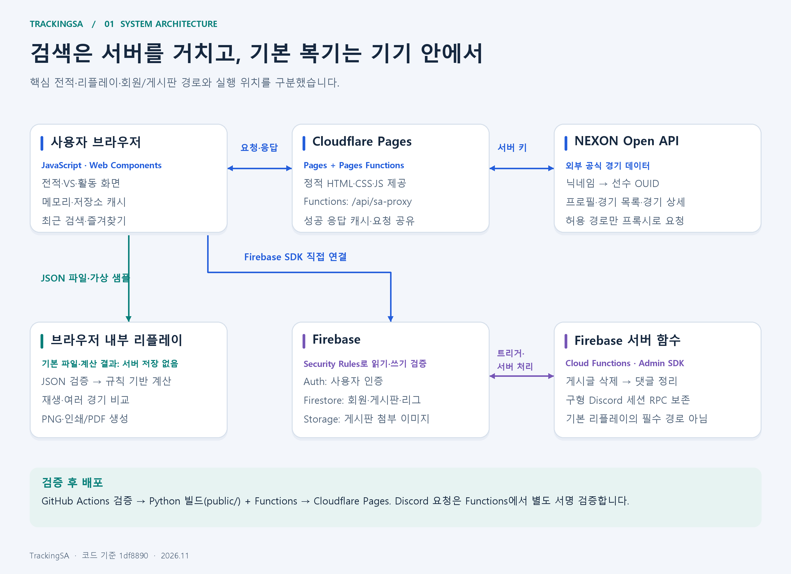
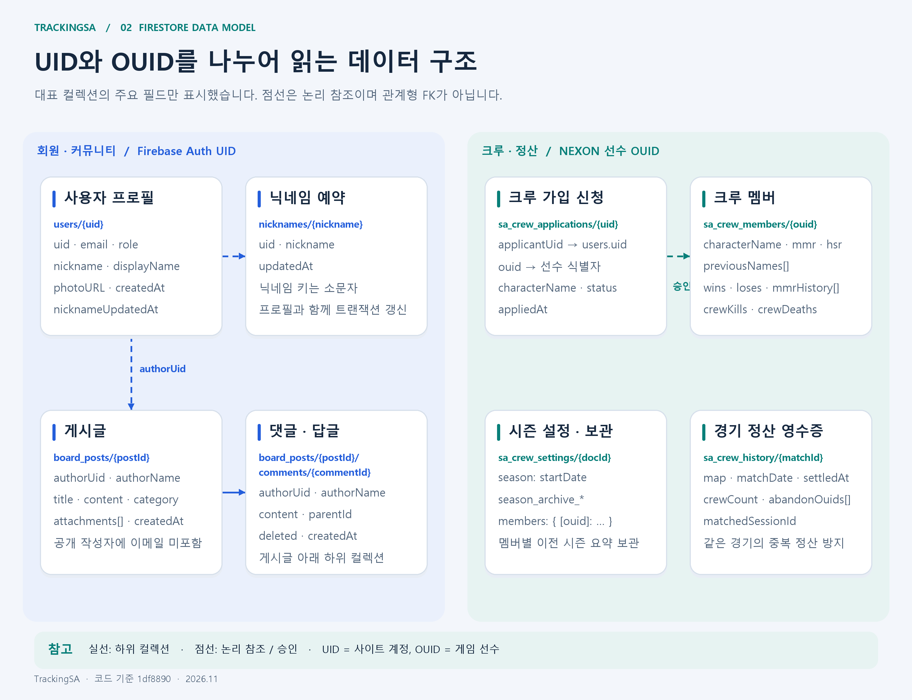
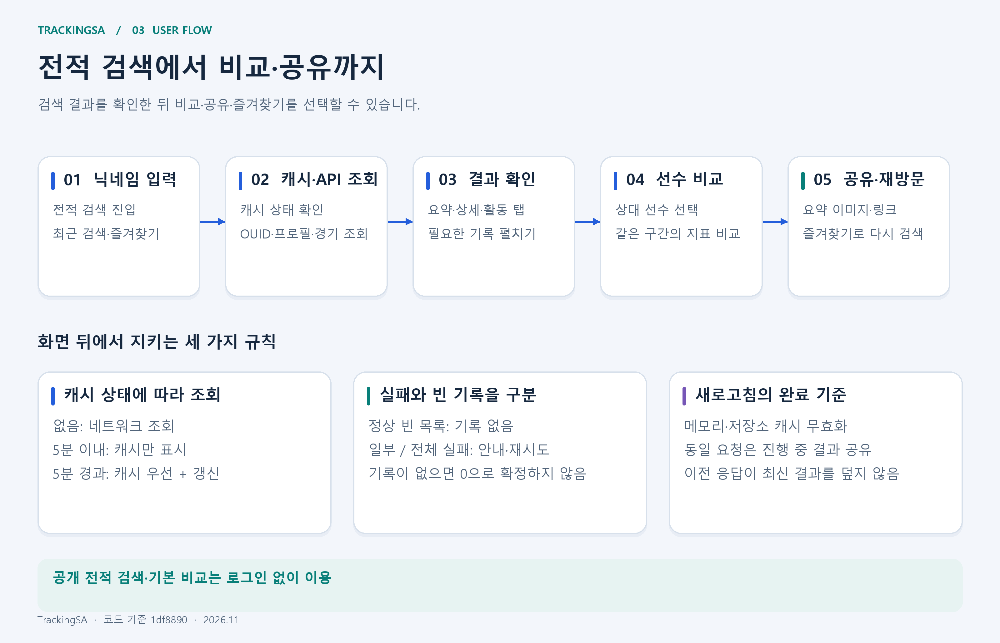
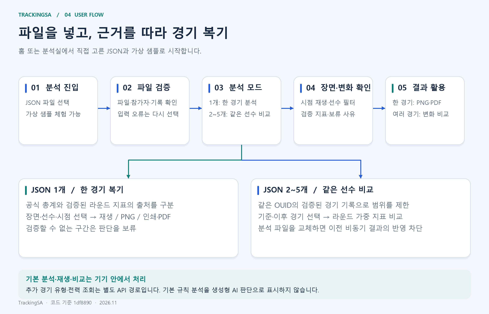

# TrackingSA 구조와 사용자 흐름

[프로젝트 소개](../README.md) · [API 명세](portfolio-api.md) · [문제 해결 사례](portfolio-case-studies.md)

2026.11.24 확인한 원본 커밋 `1df8890`의 구현을 기준으로 작성했습니다. 그림은 실제 코드의 주요 경로를 요약한 것이며 운영 DB 데이터나 트래픽을 추출한 결과는 아닙니다. 컬렉션 필드는 대표 항목을 표시합니다.

## 1. 아키텍처

[SVG 원본](images/portfolio-architecture.svg)

| 경로 | 실행 위치와 책임 | 코드 근거 |
| --- | --- | --- |
| 전적 검색 | 브라우저 → Pages Functions → NEXON Open API. 서버에서 키를 붙이고 허용된 경로의 성공 응답을 캐시 | [NEXON 클라이언트](../src/domains/stats/sudden-attack/infra/nexon-api-client.js), [프록시](../functions/api/sa-proxy.js) |
| 기본 리플레이 | 사용자가 고른 JSON 또는 가상 샘플 → 브라우저에서 검증·규칙 계산·재생·비교·출력 | [리플레이 도메인](../src/domains/stats/sudden-attack/replay/domain/), [작업 흐름](../src/domains/stats/sudden-attack/replay/application/) |
| 로그인·게시판·크루 | 브라우저의 Firebase SDK가 Auth·Firestore·Storage와 직접 통신. 보안 규칙으로 권한과 입력 검증 | [인증 저장소](../src/domains/auth/infra/firebaseAuthRepository.js), [Firestore 규칙](../firestore.rules), [Storage 규칙](../storage.rules) |
| 댓글 정리 등 서버 작업 | Firebase Cloud Functions와 Admin SDK. 기본 리플레이 분석과 별개 | [서버 함수](../cloud-functions/) |
| Discord 명령 | Pages Functions에서 Discord 서명 검증 후 명령 처리. 요약과 웹 상세 분석 연결 | [Interactions 진입점](../functions/api/discord-interaction.js) |
| 검증·배포 | 원본 서비스는 공통 검사 후 Python으로 정적 산출물을 만들고 Cloudflare에 배포 | [사이트 워크플로](../.github/workflows/site-deploy.yml) |

기본 리플레이 파일과 계산 결과는 서버에 저장하지 않습니다. 선택적 경기 유형·전력 조회는 별도 외부 API 경로입니다. 생성형 AI·결제 준비 코드는 기본 규칙 분석과 구분하며, 이 그림은 유료 AI가 활성화됐다는 의미가 아닙니다.

공개 저장소의 배포 작업은 원본 저장소 조건으로 제한되어 있습니다. 운영 환경변수와 계정 정보도 예시값으로 바꿨습니다. [공개판 범위](portfolio-snapshot.md)

## 2. Firestore 데이터 모델

[SVG 원본](images/portfolio-data-model.svg)

Firestore의 컬렉션·문서 구조입니다. 실선은 게시글 아래의 하위 컬렉션, 점선은 코드에서 사용하는 논리 참조 또는 승인 흐름을 뜻합니다. 관계형 DB의 외래 키나 조인 제약은 아닙니다.

**Firebase Auth UID는 사이트 계정, NEXON OUID는 게임 선수 식별자입니다.** 크루 가입 신청이 두 식별자를 함께 기록합니다. 모든 회원에게 게임 선수 문서가 자동으로 생기는 구조는 아닙니다.

| 문서 경로 | 주요 필드와 용도 | 읽기·쓰기 경계 |
| --- | --- | --- |
| `users/{uid}` | `uid`, `email`, `nickname`, `displayName`, `photoURL`, `role`, `subscription`, `createdAt`, `nicknameUpdatedAt`. 사이트 프로필 | 본인·운영진 읽기. 본인 프로필 쓰기는 허용 필드로 제한하며 역할·구독 임의 변경 차단 |
| `nicknames/{nickname}` | 소문자 닉네임을 문서 키로 사용. `uid`, `nickname`, `updatedAt` | 공개 읽기. 본인 소유·프로필과의 일치 조건 아래 예약·변경 |
| `board_posts/{postId}` | `title`, `content`, `category`, `authorUid`, `authorName`, `authorPhoto`, `attachments[]`, `createdAt` | 공개 읽기. 로그인·유효한 닉네임 필요. 작성자 수정·삭제, 공지 등은 운영진 권한 |
| `board_posts/{postId}/comments/{commentId}` | `content`, `authorUid`, `authorName`, `parentId`, `deleted`, `createdAt` | 자유게시글의 댓글. 로그인·닉네임 검증, 답글은 한 단계. 작성자·운영진 삭제 |
| `sa_crew_applications/{uid}` | `applicantUid`, `ouid`, `characterName`, `status`, `appliedAt` | 본인 신청·본인 또는 운영진 조회. 승인·거절은 운영진 |
| `sa_crew_members/{ouid}` | `characterName`, `previousNames[]`, `mmr`, `hsr`, `wins`, `loses`, `crewKills`, `crewDeaths`, `mmrHistory[]` | 공개 읽기, 운영진 쓰기. `loses`는 실제 코드의 필드명 |
| `sa_crew_settings/{docId}` | `season` 문서의 `startDate`. 시즌 보관 문서에는 OUID별 `members` 요약 | 공개 읽기, 운영진 쓰기 |
| `sa_crew_history/{matchId}` | `map`, `matchDate`, `crewCount`, `abandonOuids[]`, `matchedSessionId`, `settledAt` 등 정산 영수증 | 공개 읽기, 운영진 쓰기. 같은 경기의 중복 정산 방지 |

시즌 보관은 `season_archive_latest`, `season_archive_{start}_{end}`, `season_archives_index` 문서를 사용합니다. `sa_crew_history`는 모든 선수의 경기 상세를 담는 테이블이 아니라 크루 정산 이력입니다.

### 보조 데이터와 저장 규칙

| 경로 | 역할 |
| --- | --- |
| `comment_rate_limits/{uid}` | 댓글과 같은 배치에서 최근 작성 시각·댓글 ID 갱신. 10초 간격 검증 |
| Storage `board-images/{uid}/{imageId}` | 게시글 첨부 이미지. WebP·5MB 이하·소유자 메타데이터 검증. 공개 읽기, 생성·삭제 권한 제한 |
| `sa_crew_match_sessions/{sessionId}` | 참가 선수·팀과 PENDING/SETTLED 상태. 운영진 전용 크루 정산 세션 |
| `sa_crew_manual_abandons/{docId}` | 선수·경기 기준 수동 이탈 판정. 운영진 전용 |
| `popular_searches/{nickname}` | 인기 검색 집계. 공개 갱신은 카운트 증가 규칙으로 제한 |
| `match_sessions/{guildId}` | 보존된 구형 Discord 세션. 서버 Admin SDK 쓰기, 클라이언트 쓰기 차단. 크루 정산 세션과 별개 |

댓글의 루트 삭제는 답글 맥락을 남기기 위해 내용을 비우고 삭제 상태를 표시합니다. 답글은 실제 삭제합니다. 게시글 자체를 삭제하면 서버 함수가 하위 댓글을 정리합니다.

### 일관성이 필요한 변경

1. **닉네임 변경:** 닉네임 예약과 프로필을 하나의 트랜잭션에서 변경합니다. 변경 간격 제한도 검사합니다.
2. **크루 가입 승인:** 저장된 신청 문서를 다시 읽고 PENDING 상태·신청 UID·OUID를 검사합니다. 멤버 생성과 신청 상태 변경을 함께 처리하며 기존 멤버 점수를 초기화하지 않습니다.
3. **경기 정산:** 관련 멤버·정산 영수증·세션·이탈·시즌을 먼저 읽습니다. 영수증 생성, 멤버 점수 변경, 해당 세션 상태 변경을 트랜잭션으로 처리해 중복·동시 정산을 제어합니다.

근거: [인증 저장소](../src/domains/auth/infra/firebaseAuthRepository.js), [게시글 저장소](../src/domains/board/infra/firestorePostRepository.js), [댓글 서비스](../src/domains/board/application/commentService.js), [크루 저장소](../src/domains/stats/sudden-attack/infra/crew-repository.js), [가입 처리](../src/domains/stats/sudden-attack/infra/crew-application-methods.js), [정산 저장](../src/domains/stats/sudden-attack/infra/crew-settlement-store.js).

검증 코드: [Firestore 규칙 검사](../tests/unit/firestore-rules-guards.test.js), [가입 판단](../tests/unit/crew-application-decisions.test.js), [Emulator 저장소 흐름](../tests/emulator/crew-repository-workflows.test.mjs), [동시 정산](../tests/emulator/crew-settlement-concurrency.test.mjs).

## 3. 전적 검색 유저 플로우

[SVG 원본](images/portfolio-search-flow.svg)

전적 검색·기본 비교는 로그인 없이 이용합니다. 검색 결과를 확인한 뒤 상대 선수 비교, 공유 이미지·링크, 즐겨찾기를 선택할 수 있습니다. 그림의 비교·공유 단계는 필수 입력 절차가 아닙니다.

| 조회 상태 | 화면과 처리 |
| --- | --- |
| 프로필 캐시 없음 | 네트워크에서 조회 |
| 프로필 캐시 5분 이내 | 캐시만 사용 |
| 5분 경과 | 캐시를 먼저 표시하고 백그라운드 갱신 |
| 강제 새로고침 | 메모리·저장소 캐시 무효화. 이전 요청의 늦은 완료가 최신 값을 복구하지 못하도록 버전 검사 |
| 정상 빈 목록 | 기록 없음으로 표시 |
| 일부·전체 조회 실패 | 실패 상태와 재시도 안내. 빈 기록이나 실제 0으로 확정하지 않음 |

프로필 캐시와 경기 목록 캐시는 별개입니다. 경기 목록은 30초 캐시와 최대 32개 키 제한을 사용합니다. 같은 요청이 진행 중이면 결과를 공유합니다. 서버 프록시 캐시의 TTL도 별도로 적용됩니다.

근거: [프로필 조회 서비스](../src/domains/stats/sudden-attack/application/profile-query-service.js), [NEXON 클라이언트](../src/domains/stats/sudden-attack/infra/nexon-api-client.js), [프로필 테스트](../tests/unit/profile-query-service.test.js), [API 클라이언트 테스트](../tests/unit/nexon-api-client.test.js).

## 4. 리플레이 분석 유저 플로우

[SVG 원본](images/portfolio-replay-flow.svg)

사용자가 JSON 파일을 고르거나 가상 샘플을 선택해 시작합니다. 닉네임 검색이나 Discord 링크만으로 원본 리플레이 파일을 자동 수집하지 않습니다.

| 모드 | 입력·결과 | 판단 기준 |
| --- | --- | --- |
| 한 경기 복기 | JSON 1개 → 장면·선수·시점 탐색, 재생, PNG·인쇄/PDF | 공식 총계와 검증된 라운드 지표의 출처 구분. 불완전한 구간은 판단 보류 |
| 여러 경기 비교 | JSON 2~5개 → 같은 OUID의 기준·이후 경기 지표 비교 | 검증된 기록만 사용하고 라운드 수를 반영한 가중 지표 계산 |

파일을 교체하거나 작업을 종료하면 이전 비동기 조회 결과가 새 분석에 반영되지 않도록 현재 파일·세션을 검사합니다. 추가 전력 조회의 실패와 기본 파일 분석 결과도 구분합니다.

근거: [리플레이 작업 수명주기](replay-workspace.md), [비교 계산](../src/domains/stats/sudden-attack/replay/domain/replay-comparison.js), [비교 세션](../src/domains/stats/sudden-attack/replay/application/replay-comparison-session.js), [출력 제어](../src/domains/stats/sudden-attack/replay/ui/replay-output-controller.js), [브라우저 비교 검사](../tests/e2e/replay-comparison.spec.js).

---

그림은 [재생성 스크립트](diagrams/render_diagrams.py)에서 PNG와 SVG로 함께 생성합니다. [재생성 방법](diagrams/README.md)
